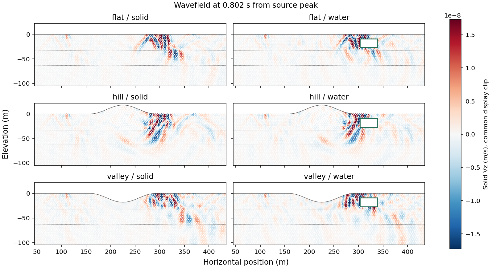

# TopoWave · 地形波场工作台

TopoWave 是一个用于二维主动源面波模拟的 PySide6 桌面程序。使用 SPECFEM2D 谱元法生成波场和完整单炮，在模型、网格和波形之间切换，比较地形、材料和洞体对面波传播的影响。



## 打开第一个例子

使用 Python 3.12，在仓库目录执行以下命令。

```sh
python -m pip install -r requirements.txt
python workbench.py
```

点击 **模板库 → 三层地形与水洞 → 三层谷地 · 36 × 18 m 水洞 → 查看已算结果**。仓库包含六份可离线打开的结果，可直接播放波场、查看完整单炮，并打开同地形的无洞对照。查看这些结果只需桌面 Python 环境。重新正演需要配置本机 SPECFEM2D 求解器。

## 模型与观测

- 可编辑平地、山丘、谷地和层状介质，检查实际谱元网格及网格质量。另有 Q 衰减、VTI、HTI 输入模板，各组合的边界和适用范围分别检查。
- 洞体可使用无牵引洞壁，或在空气、水填充时计算声固耦合。六个随包案例使用同一炮检排列和三层围岩，每种地形各算一炮无洞和一炮有水洞。
- 节点记录提供水平和竖直粒子速度。平地水平直光纤的 DAS 观测由标距两端水平速度之差除以标距得到，单位为 s⁻¹。
- 从完整单炮中选面波窗，以 PS 或 FH 计算频散能量，可叠加台阵中心一维柱的多阶理论曲线。有限洞体使用无洞背景曲线作参考。

[模型剖面](qc/layered_terrain/geometry.png) · [完整单炮](qc/layered_terrain/record.png) · [FH 与理论参考](qc/layered_terrain/FH_theory.png) · [示例参数与验证范围](qc/layered_terrain/README_zh.md)

[中文操作手册](docs/USER_MANUAL_zh.md) · [本机求解器配置](docs/release/INSTALL_zh.md) · [DAS 定义与标距](docs/release/DAS_zh.md) · [第三方来源与许可](docs/release/THIRD_PARTY_zh.md)

开发与维护 **Xin Liu** · [个人主页](https://runningxinliu.github.io/) · [联系作者](mailto:xinliu_geo@outlook.com)
